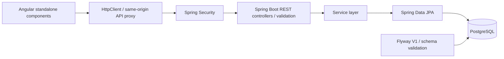
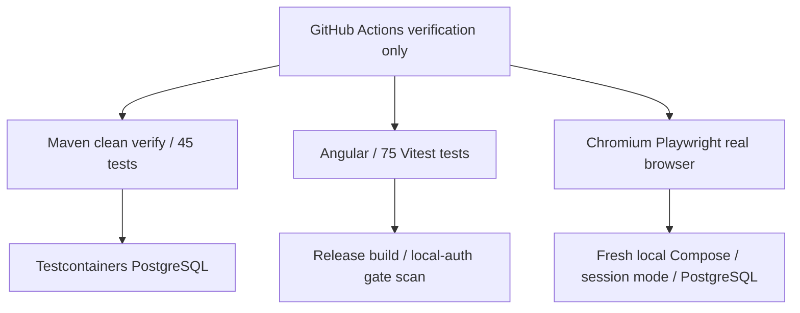

# Architecture

Independently developed full-stack enterprise application engineering demonstration using Angular 22, TypeScript, Java 21 / Spring Boot 3.5, PostgreSQL, security, testing, CI and containerized development. No commercial traffic, production multiuser identity management or distributed-scale claims.

Angular owns navigation, forms, loading/error states and session presentation. The API owns authorization, Bean Validation, pagination, status updates and timestamps. PostgreSQL is the authoritative work-order store. Support tickets are a separate fictional in-memory Angular feature and reset on reload.

## Local orchestration and verification

Docker Compose creates a dedicated network, PostgreSQL volume and non-root API container. PostgreSQL has no published port; the API is published only at 127.0.0.1:8080. The Angular development server at 127.0.0.1:4200 proxies relative /api requests without changing Origin/Host. Browser credentials never enter the static release configuration.

Flyway creates V1 in a fresh development database; Hibernate validates rather than creates the managed schema. Production Flyway adoption remains separately gated by [PRODUCTION_ADOPTION.md](PRODUCTION_ADOPTION.md). Testcontainers tests use disposable PostgreSQL to test migrations, JPA and schema lifecycle; H2 supports faster controller/service tests.

Frontend CI checks out the backend at an explicit reviewed commit, builds its JAR and runs the same browser harness. Pinning makes cross-repository verification reproducible; advance the pin deliberately after contract changes. CI neither publishes a site nor deploys a backend.

## Authentication boundaries

| Mode | Reads | Writes | Session endpoints |
| --- | --- | --- | --- |
| Default/production backend | Public fictional work-order GET | Existing Basic-auth API clients | Denied; controller/chain excluded |
| Explicit dev + local-browser backend | Public fictional GET | Session + CSRF + literal loopback Host/Origin | Explicit enablement, strict profile guards |
| Release Angular | Read-only work orders; in-memory tickets | No API write transport or local login | Disabled |
| Explicit local-browser Angular | API work orders + in-memory tickets | Loopback dev origin only; session transport | Login, restoration, expiry, logout |

The public website links to a previously published dashboard/API demo. Its currently deployed version is separate from the new local authenticated workflow. Public GET data includes requesterEmail; only fictional example.com records are appropriate. Public frontend routing is a separate recommendation in the frontend [case study](https://github.com/gizraelian/angular-support-dashboard/blob/main/docs/PORTFOLIO_CASE_STUDY.md).

Limits: single development principal, in-process sessions, local HTTP exception, no roles, no rate limiting, no idempotency keys, no session durability across API restart, and backend timestamps without timezone. See [security design](SECURITY_DESIGN_SUMMARY.md).
